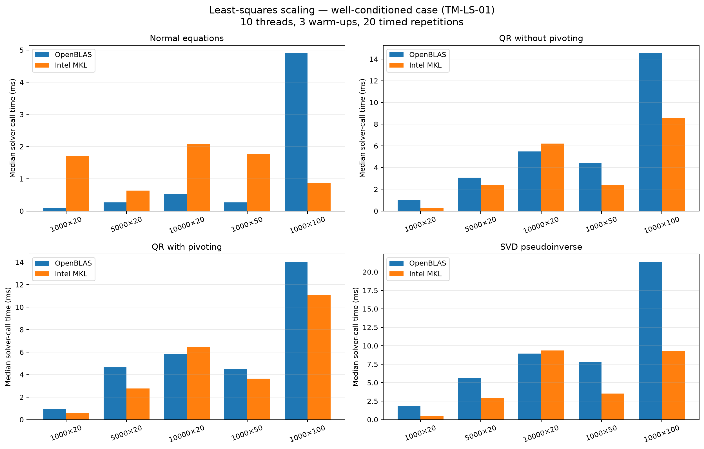
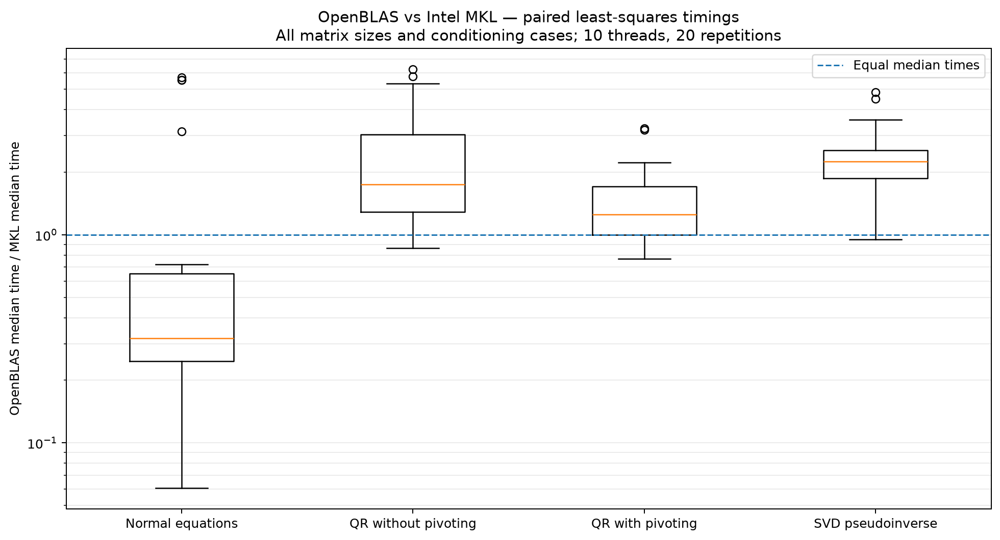

# TerraMatrix — Comparaison OpenBLAS / Intel MKL

## 1. Objectif

Comparer les performances et le comportement numérique de quatre méthodes
de résolution des moindres carrés sous OpenBLAS et Intel MKL.

Les expériences utilisent des matrices synthétiques reproductibles et font
varier les dimensions ainsi que le conditionnement.

## 2. Environnement expérimental

| Paramètre | Valeur |
|---|---|
| Système | Windows 11 64 bits |
| Python | 3.12.15 |
| NumPy | 2.5.4 |
| SciPy | 1.18.1 |
| OpenBLAS | 0.3.34 |
| Intel MKL | 2026.2-Product |
| Threads | 10 par backend |
| Warm-ups | 3 |
| Répétitions chronométrées | 20 |
| Chronomètre | time.perf_counter_ns |
| Graine aléatoire | 20261022 |
| Bruit ajouté | 0.001 |

Les backends ont été vérifiés séparément avec threadpoolctl.
Les 184 tests et Ruff ont réussi dans les deux environnements.

## 3. Méthodes et dimensions

Méthodes :
- Équations normales.
- QR sans pivotage.
- QR avec pivotage des colonnes.
- Pseudo-inverse par SVD.

Dimensions :
- 1000 x 20.
- 5000 x 20.
- 10000 x 20.
- 1000 x 50.
- 1000 x 100.

Les expériences comprennent un cas bien conditionné, des cas avec des
conditionnements cibles de 10^2, 10^4 et 10^6, ainsi qu'un cas de rang déficient.

## 4. Protocole de mesure

Chaque méthode est précédée de trois warm-ups et chronométrée vingt fois.
Les rapports conservent les médianes, les écarts interquartiles, les statuts
des solveurs et les métriques numériques.

Le temps mesuré couvre l'appel public du solveur sur des entrées déjà
construites. Il inclut la validation des entrées et la préparation mémoire,
mais exclut la génération des matrices et les métriques calculées après
la résolution. Il ne représente donc pas uniquement le temps passé dans
une routine BLAS ou LAPACK.

## 5. Résultats principaux

Le ratio est défini par :

    ratio = médiane(OpenBLAS) / médiane(MKL)

Un ratio supérieur à 1 favorise MKL ; un ratio inférieur à 1 favorise OpenBLAS.

| Méthode | Comparaisons appariées | MKL plus rapide | OpenBLAS plus rapide | Ratio médian |
|---|---:|---:|---:|---:|
| Équations normales | 20 | 4 | 16 | 0.319 |
| QR sans pivotage | 25 | 21 | 4 | 1.744 |
| QR avec pivotage | 25 | 18 | 7 | 1.253 |
| Pseudo-inverse SVD | 25 | 22 | 3 | 2.248 |

Au total, 95 comparaisons ont disposé de temps exploitables pour les deux
backends. Cinq comparaisons ont été exclues faute de temps exploitable.

Les ratios sont des médianes calculées sur plusieurs dimensions et cas
numériques. Ils décrivent les expériences réalisées, pas une supériorité
universelle d'un backend.

## 6. Variabilité des mesures

Sur les 192 séries chronométrées disposant d'une médiane et d'un IQR,
52 présentent un IQR supérieur à 25 % de leur médiane.

Une analyse de sensibilité a retenu les comparaisons pour lesquelles l'IQR
des deux backends ne dépassait pas 25 % de leur médiane.

| Méthode | Comparaisons stables | Ratio médian OpenBLAS/MKL |
|---|---:|---:|
| Équations normales | 6 | 0.254 |
| QR sans pivotage | 18 | 1.718 |
| QR avec pivotage | 12 | 1.142 |
| Pseudo-inverse SVD | 14 | 1.972 |

Ce filtrage réduit l'échantillon et peut introduire un biais. Le seuil de
25 % est un indicateur exploratoire, pas un critère universel d'invalidation.
Les résultats complets restent la référence principale.

## 7. Rang déficient et stabilité numérique

Dans plusieurs cas de rang déficient, les équations normales échouent sous
les deux backends. Dans certains autres cas, MKL retourne une solution alors
qu'OpenBLAS échoue. Un statut de réussite ne garantit pas à lui seul que
la solution est numériquement fiable.

QR sans pivotage retourne parfois des coefficients de norme extrêmement
grande, alors que QR avec pivotage et SVD produisent des normes beaucoup
plus raisonnables dans les cas examinés.

Il faut analyser conjointement le résidu, la stationnarité, la norme des
coefficients et le rang numérique. Le résidu seul ne suffit pas.

## 8. Figures

### Temps médians selon la taille des matrices

Cette figure présente le cas bien conditionné TM-LS-01.

### Ratios de temps OpenBLAS / MKL

Un ratio supérieur à 1 favorise MKL ; un ratio inférieur à 1 favorise OpenBLAS.
L'axe vertical est logarithmique et les comparaisons portent sur les temps
médians appariés disponibles.

## 9. Fichiers associés

Données :
- results/experiments/least_squares_comparison_t10_r20.csv
- results/experiments/least_squares_speedup_t10_r20.csv
- results/experiments/least_squares_speedup_summary_t10_r20.csv
- results/experiments/least_squares_speedup_stable_t10_r20.csv
- Les dix rapports JSON least_squares_size_*_t10_r20.json.

Script de visualisation :
- scripts/plot_least_squares_benchmarks.py

## 10. Limites et perspectives

Les expériences utilisent des matrices synthétiques sur un seul ordinateur.
Elles ne démontrent pas encore le comportement des méthodes sur des données
satellitaires réelles. Certaines mesures présentent une dispersion importante.

Les étapes suivantes consistent à analyser davantage les mesures dispersées,
à étudier séparément les opérations BLAS et LAPACK, puis à appliquer ces
méthodes à un cas concret d'observation de la Terre.
